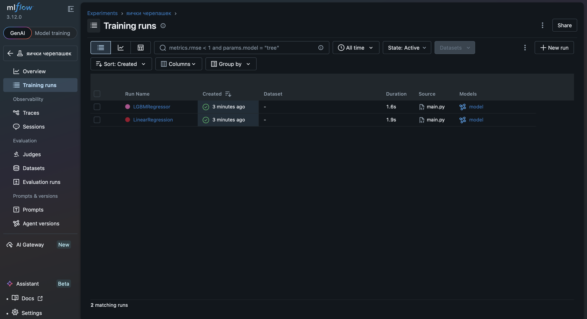
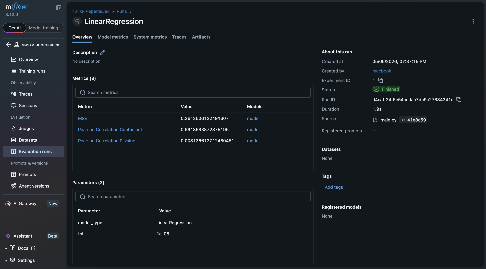
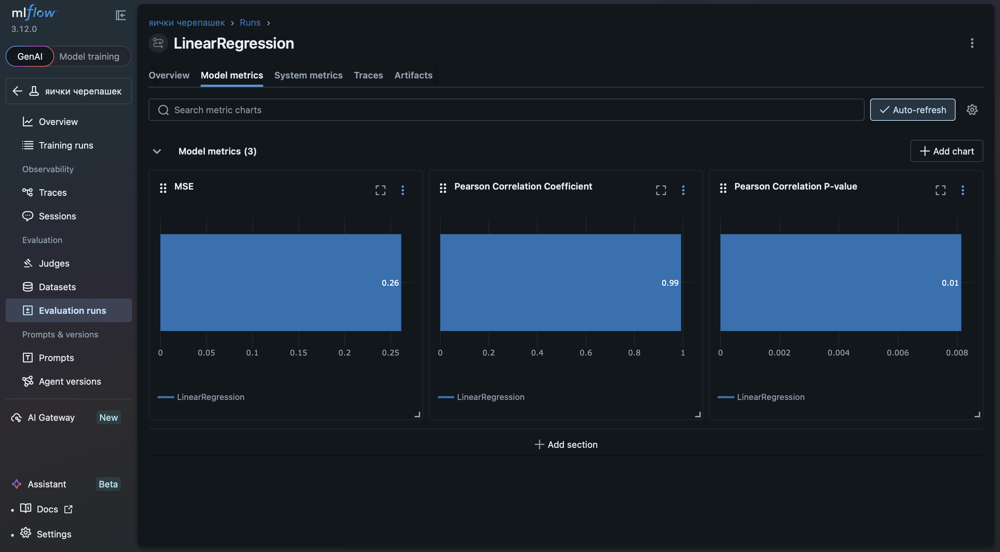
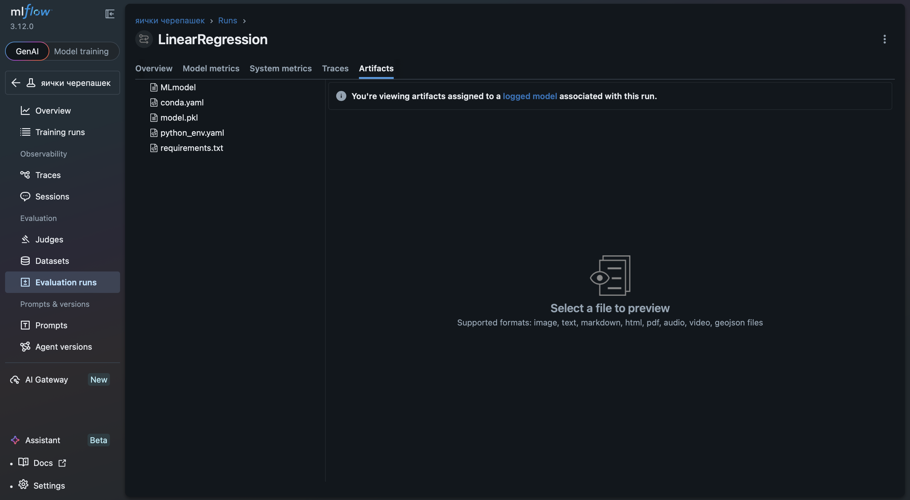
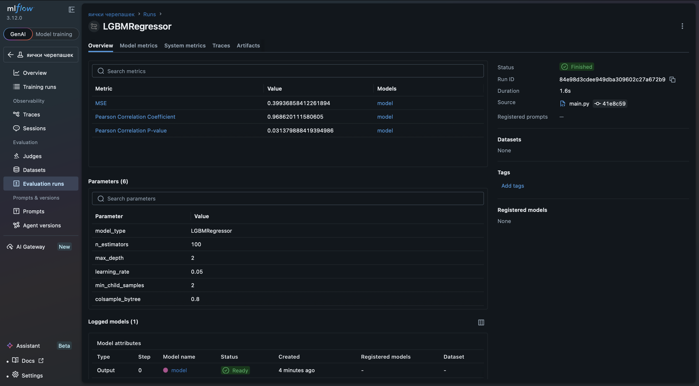
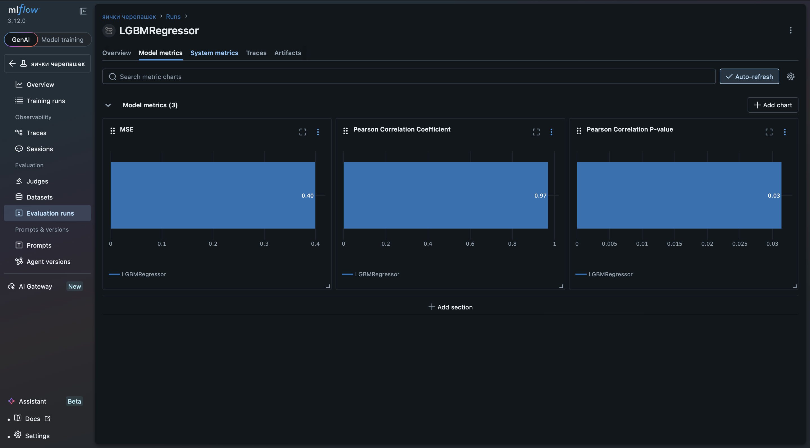
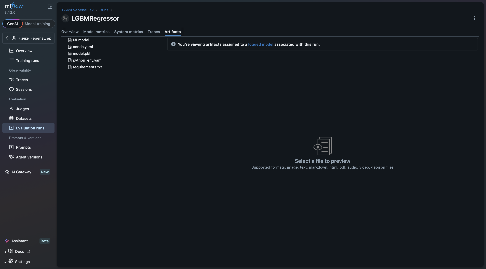
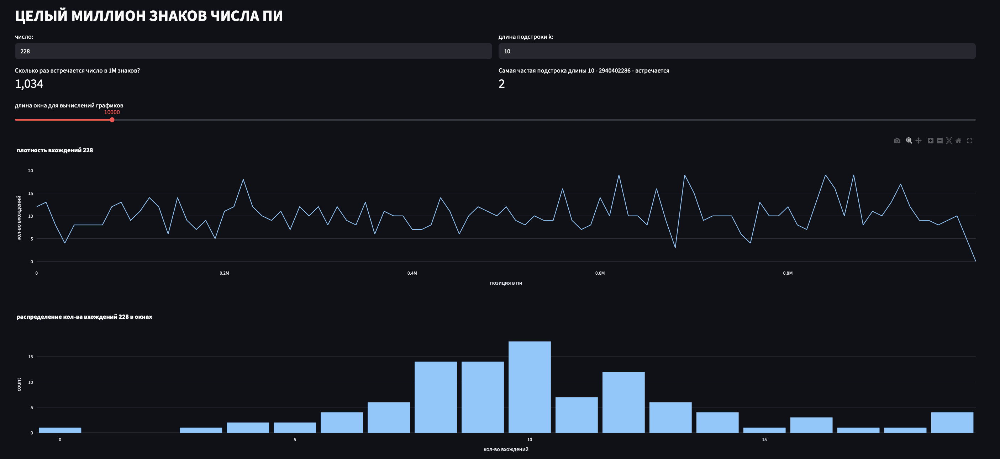

## Task 2

### [`main.py`](./main.py)

тут просто код для запуска с `mlflow`. как это выглядит:

это какое-то странное задание? там получается всего ~50 точек для обучения + теста. обьясню:

есть черепаха. у нас есть описание кладок для черепах (всего 53 записи). при чем понятно, что черепаха может делать кучу кладок за всю жизнь, поэтому валиднее считать за одну кладку связку "черепаха-год". 
поэтому при `inner_join` теряется часть инфы, так как для некоторых черепах нет описаний в некоторые годы. итого остаемся с 40+ точками на обучение и тест... зато метрики ахеренно большие (они не значимые)))))

но вот все работает

## Task 3

# [`app.py`](./app.py)

не было особо времени копаться с цветами и тд, но оч прикольно, мне понравилось. намного удобнее сраного bokeh
пикча чтоб не запускать
